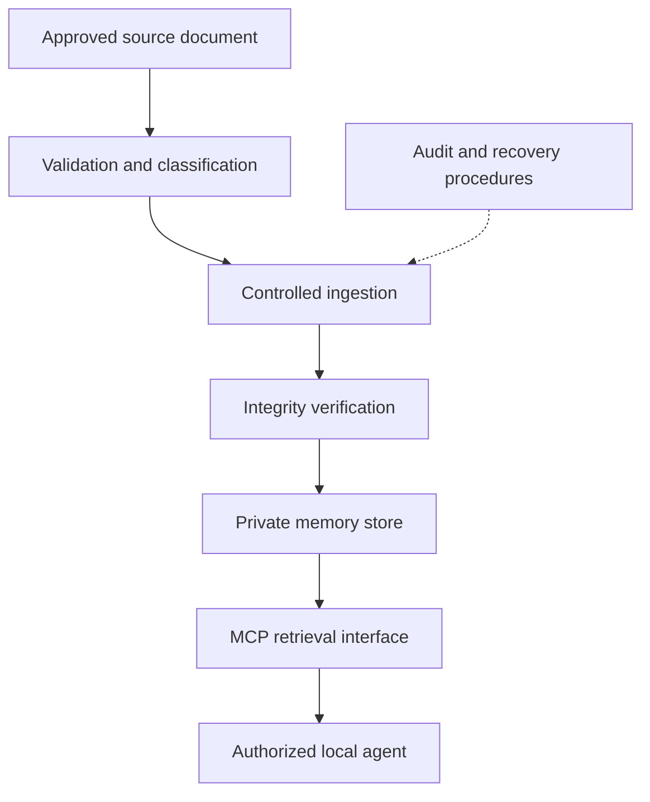

# Persistent AI Memory — Engineering Case Study

> **Scope:** Architecture and operational practices. This is a documentation-only case study, not a runnable reproduction of the private deployment.

## Problem

AI assistants and local agents lose useful operational context between sessions. A reliable memory layer must support retrieval, distinguish current rules from historical decisions, and preserve confidentiality.

## Publicly documented implementation

The repository's original implementation describes a local pipeline using Python, Ollama, FAISS, embeddings, a knowledge graph, and agent-side retrieval wrappers. The README records an OpenAI-export processing exercise, a semantic index, and graph queries. Those measurements describe the **original implementation**, not benchmarks of a newer Cognee-based system.

## Later operational evolution — disclosure boundary

The private ecosystem subsequently adopted Cognee and MCP-based retrieval, with controlled ingestion and integrity checks. The operational installation, source datasets, internal paths, identifiers, configuration, and network topology are **not published here**. This section describes engineering practices rather than offering independent verification of the current private deployment.

### High-level conceptual flow

This is a **conceptual, sanitized diagram**, not an exact deployment map.

## Engineering decisions

| Concern | Approach | Why it matters |
| --- | --- | --- |
| Source integrity | Preserve source copies and compare cryptographic digests | Detect unexpected content changes |
| Repeat ingestion | Check existing records and handle duplicates deliberately | Reduce conflicting memory entries |
| Retrieval quality | Test known facts and distinguish evidence from inference | Reduce incorrect agent context |
| Failure handling | Log and review ingestion failures before recovery | Avoid silent corruption |
| Confidentiality | Keep source datasets and operational configuration private | Prevent exposure of personal or business information |

## What this repository demonstrates

- Problem decomposition for persistent agent context.
- Practical local RAG and knowledge-graph experimentation, as described in the original README.
- Design of auditable memory workflows and operational recovery practices.
- A security-first approach to explaining private AI infrastructure.

## Evidence and limitations

**Available in this public repository:** architecture documentation, an implementation guide, case study, and lessons learned.

**Not available here:** private Cognee/MCP implementation source, full deployment configuration, production telemetry, independent benchmark results, or a public test environment. No claims are made that this repository can reproduce the current private system end to end.

## Security and publication policy

Do not commit personal conversation exports, client or patient records, credentials, tokens, real hostnames, local absolute paths, private dataset identifiers, network diagrams showing production topology, or screenshots with identifiable content. Before publication, inspect the complete diff and repository history for sensitive material.

## Next engineering milestones

1. Build a **synthetic-only** example dataset and an isolated retrieval demonstration.
2. Add automated tests for ingestion idempotency, integrity, and retrieval expectations.
3. Document reproducible local setup without private dependencies.
4. Publish results only after tests and security review have been executed.

---

*Prepared as a reviewable portfolio document. It distinguishes the documented public implementation from the private operational evolution.*
